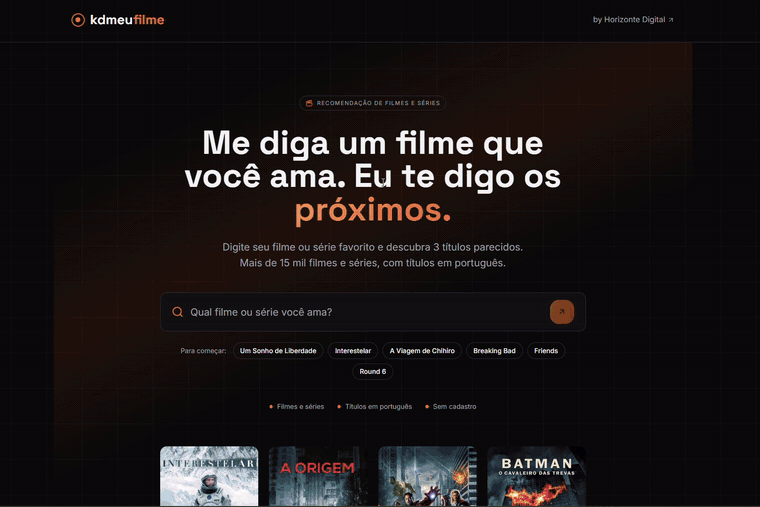
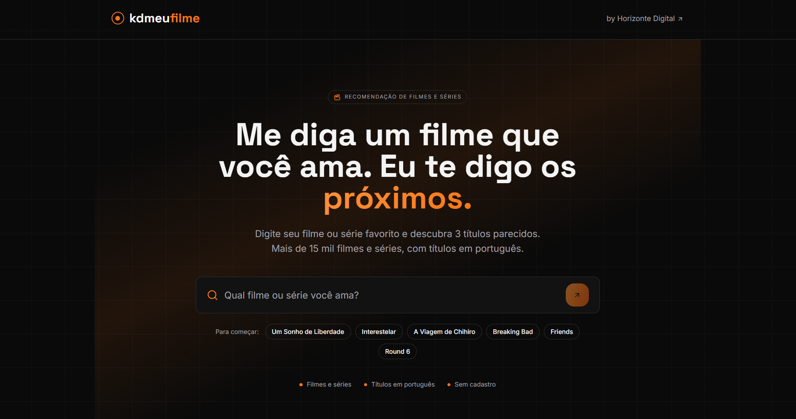
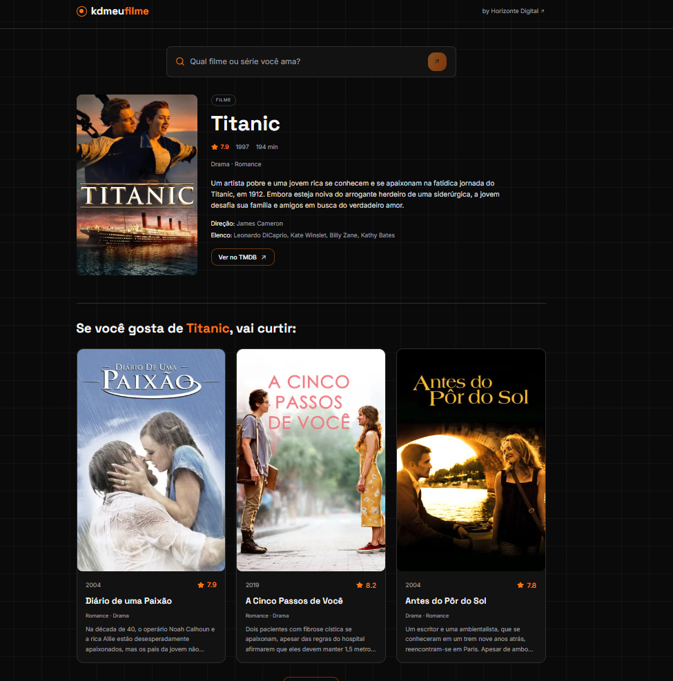
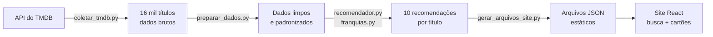
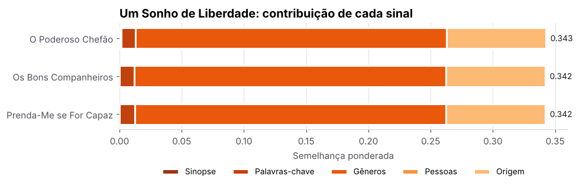
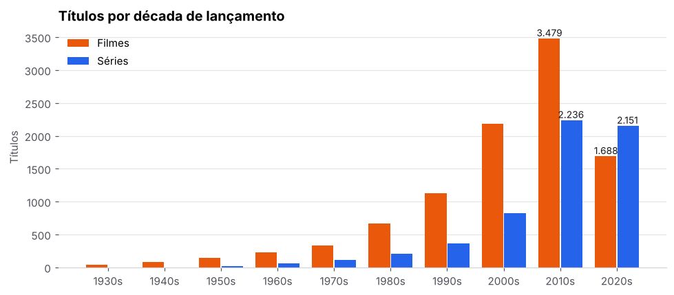

# 🎬 kdmeufilme

**Me diga um filme que você ama. Eu te digo os próximos.**

Sistema de recomendação de filmes e séries em português, construído do zero: você digita um título favorito e recebe 3 títulos parecidos, do mesmo tipo (filme → filmes, série → séries), com pôster, nota e sinopse.

### 👉 [Veja funcionando: horizontedigital.org/kdmeufilme](https://horizontedigital.org/kdmeufilme)



| Busca | Recomendações |
|---|---|
|  |  |

---

## Resumo

| | |
|---|---|
| **Problema** | Gastar mais tempo escolhendo o que assistir do que assistindo |
| **Solução** | Recomendação baseada em conteúdo a partir de um único título, sem cadastro |
| **Dados** | 15.979 filmes e séries da API do TMDB, com títulos e sinopses em português |
| **Técnica** | TF-IDF em 5 sinais + similaridade de cosseno ponderada + re-ranqueamento por qualidade + filtro de franquias |
| **Stack** | Python (pandas, scikit-learn, NumPy) · React + TypeScript + Tailwind · Lovable · GitHub |
| **Resultado** | Site público, rápido e sem servidor: as recomendações são pré-calculadas |

## Exemplos reais

| Você ama | O kdmeufilme recomenda |
|---|---|
| Um Sonho de Liberdade | O Poderoso Chefão · Os Bons Companheiros · Prenda-Me se For Capaz |
| Cidade de Deus | Tropa de Elite · Os Donos da Rua · Um Sonho de Liberdade |
| A Viagem de Chihiro | Meu Amigo Totoro · O Serviço de Entregas da Kiki · Mary e a Flor da Feiticeira |
| Toy Story | Carros · Zootopia · Vida de Inseto *(sem continuações da própria franquia)* |
| Breaking Bad | Better Call Saul · Narcos · Filhos da Anarquia |
| Friends | Como Eu Conheci Sua Mãe · Seinfeld · New Girl |

## Como funciona



Todo o cálculo é feito **uma vez, offline**, em Python. O site só lê arquivos JSON com as respostas prontas: não tem servidor, banco de dados nem custo por acesso.

## Metodologia

### Por que filtragem baseada em conteúdo

A filtragem **colaborativa** ("quem gostou de X também gostou de Y") depende de um histórico de avaliações de usuários, e a base do TMDB não traz avaliações individuais. A filtragem **baseada em conteúdo** ("Y se parece com X") usa só as características dos títulos e funciona a partir de **um único título**, o que resolve o problema de partida a frio (*cold start*) para quem nunca usou o site.

### 1. Representação: TF-IDF em cinco sinais

| Sinal | Peso | Como é vetorizado |
|---|---|---|
| Sinopse | 0,30 | Palavras e bigramas da sinopse em inglês, sem *stop words*, com frequência em escala logarítmica |
| Palavras-chave | 0,25 | Cada palavra-chave do TMDB é um termo inteiro ("time travel"); palavras de "tom" ("bold", "hilarious") são removidas |
| Gêneros | 0,25 | O IDF dá mais peso aos gêneros raros: ter **Faroeste** em comum vale quase 3× mais que ter **Drama** |
| Pessoas | 0,12 | Direção (ou criação, em séries) e os 5 atores principais |
| Origem | 0,08 | País de produção e idioma original |

### 2. Similaridade e re-ranqueamento

```
semelhança = Σ peso_sinal × cosseno(sinal)
pontuação  = 0,80 × semelhança + 0,20 × qualidade
qualidade  = 0,6 × (nota ÷ 10) + 0,4 × log(1 + votos) ÷ máximo
```

Filmes só são comparados com filmes, e séries com séries. O cálculo é feito em blocos de 1.000 linhas, para caber na memória, com seleção dos melhores via `numpy.argpartition`. Os 15.979 títulos são processados em cerca de 10 segundos.

### 3. Filtro de franquias (diversidade)

Sem o filtro, **20% dos filmes** receberiam continuações da própria franquia entre as 3 recomendações (Toy Story → Toy Story 2, 3 e 5). A regra em [`pipeline/franquias.py`](pipeline/franquias.py) remove títulos com o mesmo nome base, o mesmo "universo" do TMDB (como o da Marvel) ou nome contido no outro com pessoas ou temas em comum, e mantém no máximo um título por franquia na lista.

### 4. Explicabilidade: o que a análise revelou

Como a semelhança é uma soma de partes, dá para ver **quanto cada sinal contribuiu** para cada recomendação:



Essa análise revelou o principal ponto a melhorar: **gêneros e origem respondem por 82% a 86% da semelhança**, porque a similaridade de cosseno dos gêneros chega a 1,0 com facilidade, enquanto a das sinopses raramente passa de 0,2. Testei normalizar a escala de cada sinal, e o resultado não foi uma melhoria clara: as recomendações ficaram mais fiéis ao tema, mas também mais obscuras e com ruídos. A versão publicada continua sendo a original, e a comparação completa está no [notebook](notebooks/analise_e_recomendacoes.ipynb).

## Notebook de análise

O notebook [`analise_e_recomendacoes.ipynb`](notebooks/analise_e_recomendacoes.ipynb) traz a análise exploratória dos dados, o efeito do IDF, as recomendações, a explicabilidade, o experimento de normalização e o antes e depois do filtro de franquias.



## Estrutura do repositório

```
├── pipeline/                       Pipeline de dados em Python
│   ├── coletar_tmdb.py             1. Coleta filmes e séries na API do TMDB
│   ├── preparar_dados.py           2. Limpeza e padronização
│   ├── recomendador.py             3. TF-IDF, similaridade e re-ranqueamento
│   ├── franquias.py                   Regra de detecção de franquias
│   ├── gerar_arquivos_site.py      4. Gera os JSON estáticos do site
│   └── testar_recomendacoes.py     Mostra recomendações no terminal
├── notebooks/
│   └── analise_e_recomendacoes.ipynb
├── site/                           Front-end (React + TypeScript + Tailwind)
│   ├── src/pages/KdMeuFilme.tsx    Páginas: inicial, título e sobre
│   ├── src/components/movies/      Busca com autocompletar e pôsteres
│   └── src/lib/movie-catalog.ts    Leitura dos JSON, busca (Fuse.js) e testes
├── docs/img/                       Imagens do README
├── requirements.txt
└── .env.exemplo                    Modelo do arquivo com o token do TMDB
```

## Como rodar

**Pré-requisitos:** Python 3.10+, Node.js 18+ e uma chave de API do TMDB (gratuita para uso não comercial, em [themoviedb.org](https://www.themoviedb.org/settings/api)).

### 1. Gerar os dados

```bash
python -m pip install -r requirements.txt
cp .env.exemplo .env          # e cole o seu "API Read Access Token" no .env

python pipeline/coletar_tmdb.py           # ~15 a 30 min (use --teste para uma amostra)
python pipeline/preparar_dados.py
python pipeline/gerar_arquivos_site.py    # grava em site/public/dados/

python pipeline/testar_recomendacoes.py "Um Sonho de Liberdade" "Friends"
```

### 2. Rodar o site

```bash
cd site
npm install
npm run dev        # abre em http://localhost:5173/kdmeufilme
npm test           # testes da busca e da leitura dos dados
```

Os dados do TMDB **não são redistribuídos** neste repositório: são gerados localmente pelo pipeline, com a sua chave.

## Limitações e próximos passos

- **Escala dos sinais:** calibrar os pesos (normalização ou pesos aprendidos) e validar com testes A/B no site.
- **Sem métrica offline:** sem avaliações de usuários, a validação foi qualitativa. Coletar feedback no site permitiria medir precisão@k.
- **Semântica:** usar *embeddings* (*sentence-transformers*) nas sinopses, para que "detetive" e "policial" contem como parecidos.
- **Franquias com nomes diferentes:** usar a coleção do TMDB (`belongs_to_collection`) para detectar casos como Harry Potter → Animais Fantásticos.
- **Modelo híbrido:** combinar com filtragem colaborativa (por exemplo, com o MovieLens).

## Créditos

Dados e pôsteres: [TMDB (The Movie Database)](https://www.themoviedb.org). **Este produto usa a API do TMDB, mas não é endossado nem certificado pelo TMDB.** Projeto gratuito e sem fins comerciais.

Interface criada com [Lovable](https://lovable.dev) e publicada no site da [Horizonte Digital](https://horizontedigital.org).

---

Feito por **Eliéser Ribeiro** · [LinkedIn](https://www.linkedin.com/in/elieser-ribeiro-msc-72a12470/)
